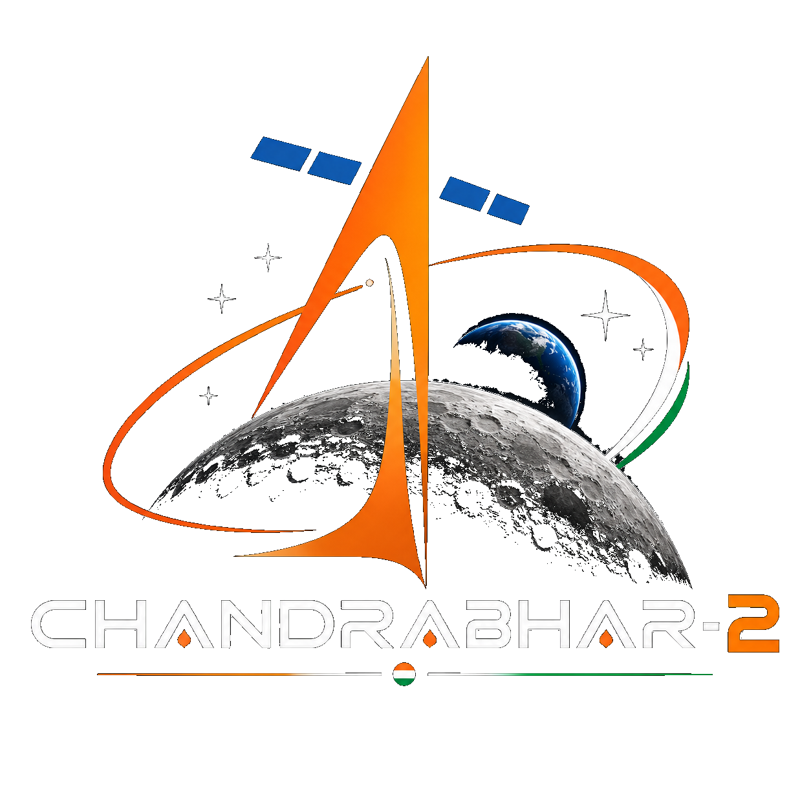

<p align="center"></p>

<h1 align="center">CHANDRABHAR-2</h1>
<p align="center"><b>Multi-modal, illumination-aware and scale-aware image correspondence for Chandrayaan-2 OHRC, TMC-2 and IIRS imagery</b></p>
<p align="center">Browser-native · files never leave your device · Engine v8.1.0 · Platform v3.0.2-web · Independent research prototype, not an official ISRO product</p>

---

## 1. Overview and architecture

A web workspace that registers Chandrayaan-2 products against each other **entirely in your browser**. The project's own Python engine (PDS4/ENVI/NumPy/raw adapters → true swath intersection → common physical GSD grid → illumination-aware representations → SIFT → phase-correlation → ECC cascade → RANSAC → explicit evidence gate) is compiled to WebAssembly with Pyodide and runs in a Web Worker. There is no server, login, database, telemetry or external AI service.

```
Browser tab:  React/TypeScript UI  <—postMessage—>  Web Worker: Pyodide (Python 3.13 → WASM)
                                                     NumPy · SciPy · OpenCV · Shapely + app/ engine
              user's files ── File handles, read lazily in slices (never uploaded) ──┘
Vercel:       static files only (HTML/JS/CSS, /pyodide runtime, /engine bundle)
```

> **Scientific honesty.** The evidence gate tests internal geometric consistency. Passing it is **not** independent ground-truth validation, which this project has not established. All built-in demos and automated tests use *synthetic* data; real mission products have not been validated here.

Architecture details: [`docs/WEB_ARCHITECTURE.md`](docs/WEB_ARCHITECTURE.md).

### Browser deployment vs. the Streamlit reference interface

| | Browser platform (this release, deployed on Vercel) | Original Streamlit interface (`dashboard.py`, `ui/`, `run.py`) |
|---|---|---|
| Runs | in the visitor's browser (WebAssembly) | locally, on a Python server you start yourself |
| Needs | a modern browser | Python + `requirements.txt` |
| Data | selected through the browser, never uploaded | local filesystem paths |
| Status | the product | retained unchanged as a local reference UI; **not deployed** |

## 2. Supported versions

| Tool | Version |
|---|---|
| Node.js | ≥ 20 (CI and local verification use **22**) |
| npm | ≥ 10 |
| Python (native tests, optional Streamlit UI) | ≥ 3.10 (CI uses **3.12**) |
| Native test libraries | pinned in `requirements-ci.txt` to the exact versions inside the WASM runtime: NumPy 2.2.5, SciPy 1.14.1, Shapely 2.0.7, OpenCV 4.11.0.86 |
| Browser runtime | Pyodide 0.29.5 (Python 3.13, NumPy 2.2.5, SciPy 1.14.1, OpenCV 4.11.0, Shapely 2.0.7), vendored in `public/pyodide/` |

OpenCV ≥ 5.0 is **not yet qualified** (it resamples differently; see [`docs/WEB_PARITY_ANALYSIS.md`](docs/WEB_PARITY_ANALYSIS.md)).

## 3. Clean setup on Windows (PowerShell)

```powershell
# 1. Extract and enter the project (the ZIP contains one folder: CHANDRABHAR-2-main)
cd $HOME\Downloads
Expand-Archive -Force .\CHANDRABHAR-2-3.0.2-web-FIXED.zip -DestinationPath .\CHANDRABHAR-2-3.0.2
cd .\CHANDRABHAR-2-3.0.2\CHANDRABHAR-2-main

# 2. JavaScript dependencies (exact versions from package-lock.json)
node --version      # expect v20 or newer
npm ci

# 3. Python virtual environment for the native tests (pinned to the WASM runtime's versions)
python -m venv .venv
.\.venv\Scripts\Activate.ps1
python -m pip install --upgrade pip
pip install -r requirements-ci.txt
$env:PYTHON = (Resolve-Path .\.venv\Scripts\python.exe).Path    # used by the parity test's native reference
```

## 4. Run locally

```powershell
npm run dev          # http://localhost:5173 (generates the engine bundle first)
```
Production build served locally:
```powershell
npm run build
npm run preview      # http://localhost:4173
```

## 5. Run all tests

```powershell
python -m pytest -q          # scientific engine, adapters, security, bridge, canary (82 tests)
npm run build                # engine bundle + runtime checksum check + type-check + production build
npm test                     # Vitest: unit tests + native-vs-WebAssembly parity (57 tests)
npm run test:e2e             # real headless Chromium against dist/ (67 checks) — see note
```
Note: the E2E suite uses `@sparticuz/chromium` (a Linux Chromium build) and a Python fixture generator, so it runs on Linux/macOS-with-Linux-toolchain or CI; on Windows run it in WSL, or rely on GitHub Actions (`.github/workflows/ci.yml`).

The local Streamlit reference UI (optional): `pip install -r requirements.txt` then `python run.py`.

## 6. Production build

```powershell
npm run build        # output in dist/ (static files; no server needed)
```

## 7. Deploy to Vercel through GitHub

1. Push the repository to GitHub.
2. In Vercel: **Add New → Project → Import** the repository. Keep the detected **Vite** preset; `vercel.json` supplies `npm ci`, `npm run build`, output `dist`, security headers and caching.
3. **Deploy.** No environment variables, functions or databases are used.

Details, header list and a post-deploy checklist: [`docs/WEB_DEPLOYMENT.md`](docs/WEB_DEPLOYMENT.md).

## 8. Known limitations and scientific-validation warnings

* **No independent ground-truth validation.** Gate passed ≠ registration correct in absolute terms.
* Only **synthetic** fixtures have been run end to end; real Chandrayaan-2 products are unverified.
* The WebAssembly engine is single-threaded and several times slower than native; very large swaths are bounded by the memory preset's grid cap.
* Only headless Chromium was tested; Firefox, Safari and mobile devices are unverified.
* OpenCV ≥ 5.0 is not qualified (resampling precision differs; reported, not hidden, by the informational `latest-deps` CI job).
* Publishing the web build makes the engine source downloadable; see Licence.

Full list: [`docs/KNOWN_LIMITATIONS.md`](docs/KNOWN_LIMITATIONS.md).

## Documentation

| Topic | File |
|---|---|
| Architecture, diagrams, memory model | [`docs/WEB_ARCHITECTURE.md`](docs/WEB_ARCHITECTURE.md) |
| Python→WASM migration matrix and parity | [`docs/WEB_MIGRATION_PARITY.md`](docs/WEB_MIGRATION_PARITY.md) |
| Parity-failure analyses (coefficient tolerance, OpenCV 5.0) | [`docs/WEB_PARITY_ANALYSIS.md`](docs/WEB_PARITY_ANALYSIS.md) |
| Privacy & security | [`docs/WEB_PRIVACY_AND_SECURITY.md`](docs/WEB_PRIVACY_AND_SECURITY.md) |
| Formats & companion files | [`docs/WEB_FORMATS.md`](docs/WEB_FORMATS.md) |
| Browser compatibility | [`docs/WEB_BROWSER_COMPATIBILITY.md`](docs/WEB_BROWSER_COMPATIBILITY.md) |
| Performance & limits | [`docs/WEB_PERFORMANCE.md`](docs/WEB_PERFORMANCE.md) |
| Test & validation report | [`docs/WEB_TEST_REPORT.md`](docs/WEB_TEST_REPORT.md) |
| Using the app | [`docs/WEB_USER_GUIDE.md`](docs/WEB_USER_GUIDE.md) |
| Models & improvements findings | [`docs/WEB_ML_AND_IMPROVEMENTS.md`](docs/WEB_ML_AND_IMPROVEMENTS.md) |
| Dependencies & licences | [`docs/DEPENDENCIES.md`](docs/DEPENDENCIES.md) |
| Original docs (science, protocol, claims) | [`docs/01_…18_*.md`](docs/), [`docs/LEGACY_README.md`](docs/LEGACY_README.md) |
| Changelog | [`CHANGELOG.md`](CHANGELOG.md) |

The original scientific documentation, experiment protocol, claims matrix, `SIH/` materials and `LEGAL/` notices are preserved.

## Licence

Proprietary — see [`LICENSE.md`](LICENSE.md) and `LEGAL/`. **Note:** publishing the web build makes the engine source downloadable by visitors; the copyright holder must confirm this is intended.
