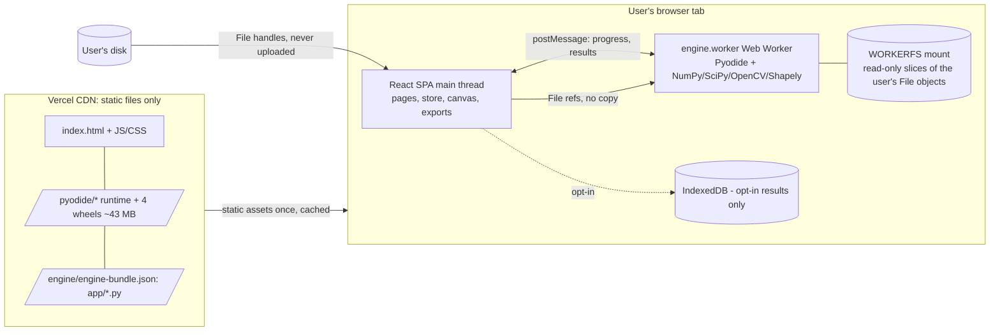
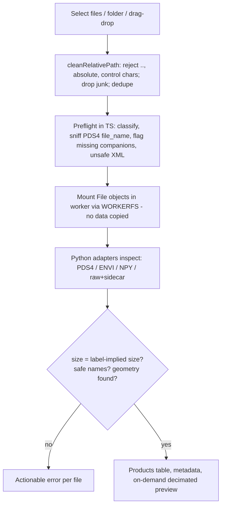
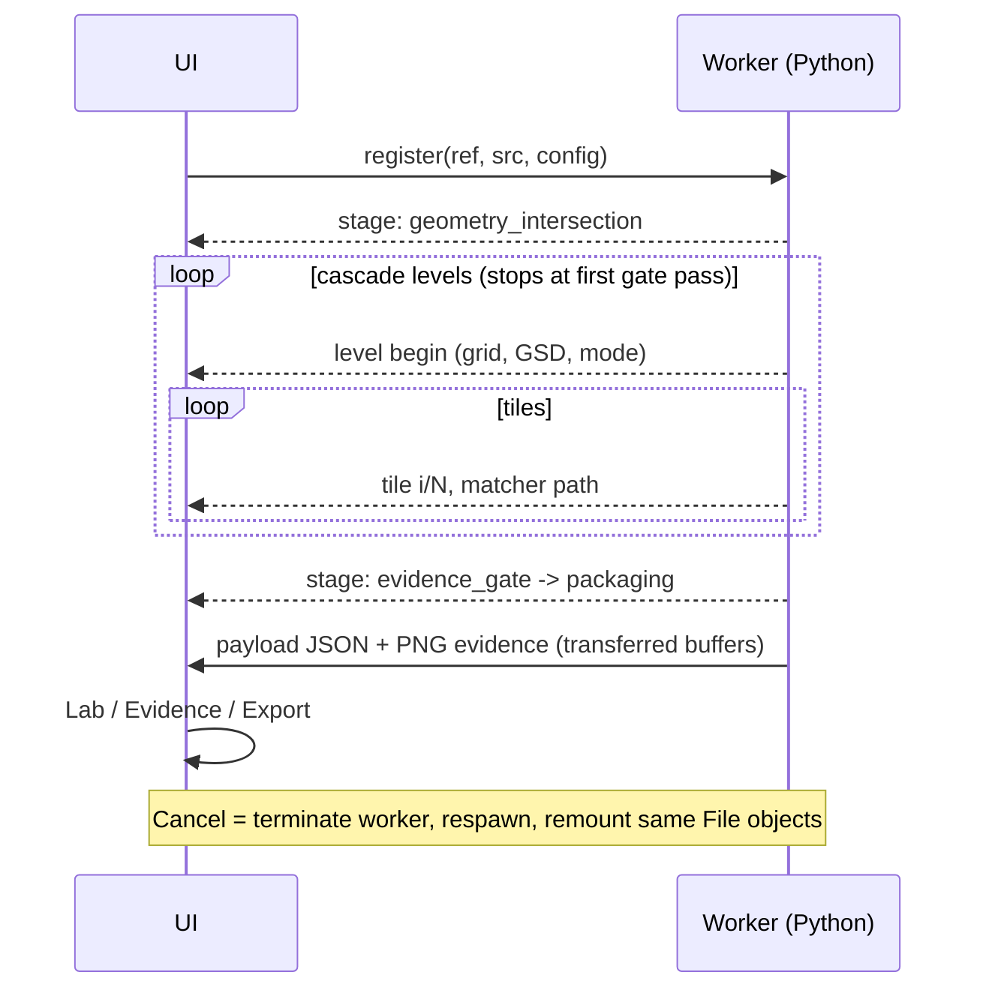

# Web architecture (platform 3.0.0-web)

## Decision: run the real Python engine as WebAssembly

The audit found that the scientific engine (~2,800 lines) rests on NumPy, SciPy (`LinearNDInterpolator`), OpenCV (SIFT, `phaseCorrelate`, `findTransformECC`, `findHomography`, `warpPerspective`) and Shapely (exact polygon intersection). Pyodide 0.29.5 ships **all four as WebAssembly wheels** (NumPy 2.2.5, SciPy 1.14.1, OpenCV 4.11.0, Shapely 2.0.7).

A TypeScript rewrite would have required re-implementing or substituting SIFT, ECC, Delaunay-based geometry interpolation and exact polygon clipping — each a place where results would silently diverge. Running the original code removes that class of risk: behaviour is the **same code**, and parity is *tested* (`tests-web/engine-parity.test.ts`) rather than assumed. WebGPU and a learned matcher were considered and rejected (see `WEB_ML_AND_IMPROVEMENTS.md`).

## Component diagram

Network traffic is limited to downloading static assets. Mission bytes, file names and results never leave the tab (verified in `tests-e2e/run.mjs`).

## File ingestion flow

The TypeScript preflight is only for instant feedback; **the Python adapters are authoritative**.

## Pipeline & worker flow

Progress is **real**: tile counts come from the engine loop. Stages without a measurable fraction use an indeterminate bar. Cascade level counts are shown as an upper bound because the cascade stops at the first level that passes.

## Memory model

* Rasters are **never loaded whole**. `LazyArray` (stream backend) reads only the window requested (a row block, or per-row segments for narrow windows). In the browser the bytes are fetched through the Emscripten FS API (`js.cb2ReadSlice`) because Python `seek()` is 32-bit in wasm32 and would fail beyond 2 GiB. Tested with a 3.2 GB sparse product.
* Bounded allocations: tile (≤768²) arrays, the common grid (capped by `max_grid_pixels`; the engine coarsens GSD when capped and the run reports `grid_capped`), geometry CSV (size-checked), evidence canvases (≤1.0–1.8 k px).
* Memory presets (Settings): conservative / standard / extended, auto-selected from `deviceMemory` and device class.

## Cancellation, recovery

Compiled code cannot be interrupted cooperatively without `SharedArrayBuffer` (cross-origin isolation). We chose the always-reliable method: **terminate the worker** (frees all memory), then `recover()` boots a fresh engine, restores limits, remounts the same File objects and regenerates demo data if active. Worker crash/OOM triggers the same path with an error message. `beforeunload` warns during a run. There is no resumable state; an interrupted run must be restarted.

## Source layout

| Path | Role |
|---|---|
| `app/` | Scientific engine (unchanged algorithms), `app/web/bridge.py` browser API, `app/safepath.py`, `app/synthetic.py` |
| `src/engine/boot.ts` | Pyodide bootstrap shared by worker and Node tests |
| `src/worker/` | Worker + client (lifecycle, cancel, recovery) |
| `src/state/store.ts` | App state and orchestration |
| `src/lib/` | Ingestion, paths, preflight, exporters, ZIP, evidence renderer, storage, capabilities |
| `src/pages/`, `src/components/`, `src/styles/` | UI and design tokens |
| `public/pyodide/` | Vendored runtime (checksummed `VENDOR_MANIFEST.json`) |
| `public/engine/` | Generated at build: `engine-bundle.json` (not committed) |
| `ui/`, `dashboard.py` | Legacy Streamlit UI, retained for local use, **not deployed** |
